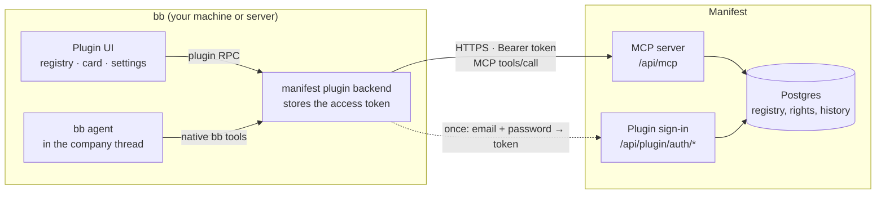

# Manifest plugins for bb


Plugins for [bb](https://github.com/get-bb/bb), the agent orchestration IDE. They
bring the **supplier outreach** workspace of **Manifest** into bb: a registry of
potential suppliers in the sidebar, an editable company card on the right, and an AI
agent chat bound to each company in the middle.

> [!NOTE]
> **Who is this for.** Manifest is a private operations service for an importer of
> spare parts and power tools (orders, logistics, payments, price lists, supplier
> outreach). It is not open source and not offered as a product. These plugins are
> published so that the team can install them with `bb plugin install` from a
> public URL. They are useful only with access to a Manifest instance. If you build
> bb plugins yourself, the code may still serve as a worked example of a bb plugin
> that talks to an external system over MCP.

> [!NOTE]
> **Language.** The plugin interface and the agent skill are in Russian, because the
> team that uses Manifest works in Russian. This repository's documentation is in
> English.

## Contents

- [What it looks like](#what-it-looks-like)
- [Plugins](#plugins)
- [How it works](#how-it-works)
- [Requirements](#requirements)
- [Installation](#installation)
- [Connecting to Manifest](#connecting-to-manifest)
- [Agent tools](#agent-tools)
- [Security](#security)
- [Updating and versioning](#updating-and-versioning)
- [Repository layout](#repository-layout)
- [Development](#development)
- [License](#license)

## What it looks like

```
┌──────────────────────┬─────────────────────────────────┬──────────────────────────┐
│ Sidebar              │ Main area                       │ Right panel              │
│ Suppliers list       │ Chat with the bb agent,         │ «Карточка» tab           │
│                      │ bound to the selected company   │                          │
│ search               │                                 │ name, legal entity, kind │
│ region ▾ country ▾   │ "Find a phone number for the    │ countries covered        │
│ priority ▾ status ▾  │  Kenyan office and add it"      │ phones, emails, sites    │
│                      │                                 │ contact persons          │
│ P1 Company A  · DE   │ agent → outreach_get_company    │ status, priority         │
│ P2 Company B  · KE   │ agent → outreach_save_contact   │ comments                 │
│ P3 Company C  · IN   │                                 │ change history           │
│ …                    │ "Done: +254 … added."           │   «… · агент BB»         │
└──────────────────────┴─────────────────────────────────┴──────────────────────────┘
```

- **Registry (left).** All potential suppliers grouped by region and country, with
  full-text search and filters by region, country (the long country list has its own
  search box), priority P1–P5 and funnel status.
- **Card (right).** Company details, countries covered, contact channels, contact
  persons, status, priority, comments and change history. Editable for users who
  have the edit permission in Manifest.
- **Chat (middle).** A bb thread linked to the company. The agent reads and edits the
  company through Manifest tools, within the same permissions as the user. Every
  change it makes appears in the card's history marked «агент BB» (“bb agent”) and
  refreshes the card at once.

### Outreach dashboard (since 0.2.0)

```
┌─ Дашборд аутрича ─ [Весь реестр] [Напоминания] [Индия] [+ Тема] ───────┬───────────────────────┐
│ Topic filter: status = contacted · country = IN · no touch ≥ 7 days [×]│ Topic chat            │
│ ┌ Waiting for us ┐┌ Overdue ┐┌ No next step ┐┌ Due today ┐┌ Ready ┐    │ You: who needs a      │
│ │       2        ││    5    ││      3       ││     1     ││  12   │    │ follow-up in India?   │
│ └────────────────┘└─────────┘└──────────────┘└───────────┘└───────┘    │ Agent: 5 companies    │
│ ┌ Today queue ──────────────────┐ ┌ What changed since last visit ┐    │ ┌ live list ─────────┐│
│ │ Dealer X · follow-up #1,       │ │ THK · status → replied        │    │ │ Dealer X · IN · 9d ││
│ │            3 days overdue      │ │ ZETA · touch ← email          │    │ └────────────────────┘│
│ └────────────────────────────────┘ └──────────────────────────────┘    │ ┌ batch: next step ──┐│
│ ┌ Funnel ─────┐ ┌ Regions ─────┐ ┌ Stagnation: status × days ┐        │ │ 5 companies  [Apply]││
└─────────────────────────────────────────────────────────────────────────┴───────────────────────┘
```

- **Today queue.** Companies that replied and wait for us, overdue next steps, steps due
  today, and companies ready but not yet contacted — each row with the reason it is
  there. This is also what the agent answers to “who needs a reminder?”.
- **Charts.** Process checks, the funnel with drop-off by reason, regions stacked by
  stage, a stagnation matrix (status × days since the last touch), data quality and
  activity. Numbers are per company; percentages appear only when the base is at
  least 20. Every tile and bar filters the topic; every row opens the card.
- **Topics.** Several agent chats on the dashboard, each with its own filter, kept as
  bb threads in the «Аутрич» section. The agent changes the topic filter, inserts live
  company lists into its replies, and prepares bulk edits as **batches**: a preview of
  every field change that a person applies (and can revert) with a button. The agent
  cannot apply a batch itself.
- **Attention counter.** “Waiting for us + overdue” next to the topic switcher in the
  dashboard header.

The dashboard needs a Manifest server with the outreach work layer (touches, next steps,
queue, metrics); the plugin detects it through `manifest_whoami.capabilities`.

### Outreach mail (since 0.3.0)

The «Почта аутрича» (“Outreach mail”) page prepares everything needed before the first
letter goes out. Mail is delivered by a separate gateway that Manifest talks to; the
plugin never sees gateway credentials.

- **Templates** by audience (potential suppliers, suppliers, potential clients,
  clients), language and kind, with versions. Text with light markup and placeholders
  from a closed list: `{{company.name}}`, `{{person.name | "Sir or Madam"}}`,
  `{{sender.name}}`, `{{signature}}`, … The legal footer is added automatically.
- **Template editor** with a placeholder palette, a template view and a view of the
  letter for a chosen organisation (empty and unknown placeholders are highlighted),
  “save” and “save as new”.
- **Template topics.** An agent chat next to the editor rewrites the draft; the user
  sees every change at once and saves the template with a button.
- **Legal entities and senders** with channel health, daily quota and queue, and the
  default sender per audience. Gateway tokens are set only in the Manifest web app.
- **Unmatched inbound mail**: replies that could not be matched to an organisation can
  be linked to one, or marked as spam or ignored. Inbound mail is untrusted and shown
  as plain text.
- The company card shows who writes to the organisation and what blocks sending.

- **Letter to an organisation (since 0.4.0).** «Подготовить письмо» in the card starts
  a draft from a template; the agent in the company chat edits it on request. The letter
  is shown as it will go out — in the card and in the chat by the
  `::manifest-letter{company="…"}` directive.
- **Mailings (since 0.4.0).** One agreed letter for many organisations: the
  `::manifest-mailing` directive and the «Рассылки» tab show what will go and what will
  not, and let you page through every recipient's letter. Text adapts to what is known
  about each recipient: `[[ in {{company.city}}]]`, `[[ a || b ]]`.

Sending letters (one by one and in bulk, always by a person) arrives in a later release. The page
needs a Manifest server with the capability `outreach.mail`.

## Plugins

| Plugin | Version | What it does |
|---|---|---|
| [`manifest`](plugins/manifest) | 0.7.0 | The outreach workspace: registry, card, company chat, outreach dashboard with topic chats, mail templates and senders, agent tools, connection settings. |
### Sending letters (since 0.7.0)

A letter or a mailing is sent by a person — «Отправить» in the chat chip or in the widget
on the right, behind a confirmation that names the recipients, the sender and the mode
(sandbox or live). The agent prepares and edits letters but has no tool to send. A sent
letter keeps a live status and the supplier's replies; a mailing shows its progress and
can be stopped. «Ответить» starts an answer in the organisation's card.

### The workspace: chat in the middle, object on the right (since 0.6.0)

Every outreach chat is a native bb thread; the object it works with — an organisation,
a mailing, a mail template, a dashboard topic or an inbound message — is shown in a tab
of the thread's side panel. The tab opens by itself and follows the thread wherever you
open it from. A thread has one object at a time and a trail: when the agent turns an
agreed letter into a mailing, the mailing opens on the right and the thread goes on with
it; «← organisation» goes back. An object may have several chats. Section pages are
pults: lists, an object on the whole screen with its chats, «Новый чат». Widgets adapt
to the narrow panel, phones and the whole screen.

### The suppliers list in the sidebar (since 0.5.0)

The plugin brings its own sidebar list, «Потенциальные поставщики» (“Potential
suppliers”), and a button for it in the sidebar footer, tinted in Manifest's soft
green like its rail sections. The button switches the sidebar between the suppliers
and whatever list was there before — bb's thread list or another plugin's. Opening the
«Аутрич» section switches the suppliers on by itself. The plugin never leaves the
sidebar on «automatic» when it switches back, so it does not take the sidebar over
when you did not ask for it. Until 0.4.0 the list was a tab of the separate
`sidebar-tabs` host; that host is no longer part of this repository.

### Navigation in bb 0.46

bb 0.46 replaced the sidebar navigation with the **rail**: a vertical strip of section
icons on the left, without labels or counters. The plugin adds three sections there,
each with its own icon: «Аутрич» (globe), «Дашборд аутрича» (dashboard) and «Почта
аутрича» (mail). Order and visibility are set in the rail's More → Customize rail.
The dashboard and card icons are declared in the plugin manifest, so they show even
while the plugin is stopped.

## How it works



- **Manifest is the single source of data and permissions.** It exposes an MCP server
  at `/api/mcp`. The list of tools a user gets depends on that user's permissions in
  Manifest, and each tool call is checked again on the server.
- **The plugin is an MCP client.** Its backend holds the access token and calls
  Manifest tools for the panels (through bb plugin RPC, so the token never reaches the
  browser) and for the agent (as native bb agent tools).
- **The agent works per company.** Manifest tools are given to the agent only in a
  thread that belongs to a company. Write tools may change only that company; read
  tools can look at the rest of the registry.
- **Contract versioning.** `manifest_whoami` returns `contract: 1`. If Manifest and the
  plugin disagree on the contract version, the plugin shows a message asking to update
  instead of failing in unpredictable ways.

## Requirements

- bb **0.46** or newer (built against plugin SDK 0.6.49).
- A Manifest account with the `outreach.view` permission; `outreach.manage` to edit.
- A **plugin password** set for that account in Manifest. It is separate from the web
  sign-in (Manifest's web interface uses Yandex sign-in).
- Network access from the bb backend to the Manifest URL over HTTPS. Plain `http://`
  is accepted only for `localhost` / `127.0.0.1` during development.

## Installation

```sh
bb plugin install https://github.com/dpetrakov/manifest-bb-plugins --plugin manifest
```

bb builds the plugins from source on install; no prebuilt artifacts are committed.

> [!NOTE]
> If you installed `sidebar-tabs` from this repository before 0.5.0, remove it
> (`bb plugin remove sidebar-tabs`) unless another plugin uses it: the suppliers list
> now lives in the `manifest` plugin itself.

## Connecting to Manifest

1. **Get a plugin password.** In Manifest, an administrator sets it in
   «Пользователи и права» → «Плагин BB» (“Users and permissions” → “bb plugin”), or
   you set your own by clicking your name at the bottom of the Manifest menu.
2. **Sign in from bb.** Open *Settings → Plugins → Manifest → «Подключение к Manifest»*
   (“Connection to Manifest”) and enter the Manifest URL, your email and the plugin
   password.
3. The plugin exchanges the password for an access token once and forgets the
   password. The token is stored as a secret plugin setting on the bb backend.
4. **Sign out** in the same section to revoke the token. You or an administrator can
   also revoke any device from Manifest.

## Agent tools

Manifest's MCP server publishes these tools. The panels can call all of them. The agent
gets a set that depends on the kind of chat: in a **company chat** it reads and edits that
one company; in a **dashboard topic** it reads the whole registry and changes data only
through batch previews; in a **template topic** it edits only the template draft. The tools a session actually receives also depend on the user's
permissions.

| Tool | Agent | Permission | Purpose |
|---|:---:|---|---|
| `manifest_whoami` | | signed in | Current user, permissions, contract version. |
| `outreach_facets` | | `outreach.view` | Regions and countries with counts, dictionaries. |
| `outreach_list_companies` | ✓ | `outreach.view` | Search and filter the registry. |
| `outreach_get_company` | ✓ | `outreach.view` | Full card, including comments, history and source text. |
| `outreach_update_company` | ✓ | `outreach.manage` | Fields, status, tags, “do not contact”, manual priority; optimistic locking with `expected_updated_at`. |
| `outreach_save_contact` | ✓ | `outreach.manage` | Add or change a phone, mobile, WhatsApp, Telegram, fax, email or website. |
| `outreach_delete_contact` | ✓ | `outreach.manage` | Remove a contact channel. |
| `outreach_save_person` | ✓ | `outreach.manage` | Add or change a contact person. |
| `outreach_delete_person` | ✓ | `outreach.manage` | Remove a contact person. |
| `outreach_add_comment` | ✓ | `outreach.manage` | Comment on a company as the user. |
| `outreach_update_comment` | | `outreach.manage` | Edit or pin one's own comment. |
| `outreach_delete_comment` | | `outreach.manage` | Delete one's own comment. |
| `outreach_queue` | ✓ both | `outreach.view` | Today queue with a reason per row. |
| `outreach_metrics` | ✓ both | `outreach.view` | Dashboard metrics for a filter, with `as_of`. |
| `outreach_feed` | ✓ both | `outreach.view` | Changes since a moment. |
| `outreach_segments` | ✓ both | `outreach.view` | Saved team segments with live counts. |
| `outreach_cadence` | | `outreach.view` | Follow-up template. |
| `outreach_batch_get`, `outreach_batches` | ✓ topic | `outreach.view` | A batch and the batch journal. |
| `outreach_log_touch` | ✓ company | `outreach.manage` | Record an email, message, call, meeting, autoreply or bounce; the cadence proposes the next step. |
| `outreach_update_touch`, `outreach_delete_touch` | | `outreach.manage` | Fix or remove a touch. |
| `outreach_set_next_action`, `outreach_complete_next_action` | ✓ company | `outreach.manage` | Plan or close the next step. |
| `outreach_save_segment`, `outreach_delete_segment` | ✓ topic (save) | `outreach.manage` | Team segments. |
| `outreach_set_cadence` | | `outreach.manage` | Change the follow-up template. |
| `outreach_batch_preview` | ✓ topic | `outreach.manage` | Prepare a bulk edit (≤ 200 companies); changes nothing. |
| `outreach_batch_apply`, `outreach_batch_revert` | never | `outreach.manage` | Apply or revert a batch — refused when called by the agent. |
| `manifest_dashboard_show` | ✓ topic | — | Plugin-local: set the topic filter shown on the dashboard. |
| `mail_fields`, `mail_templates`, `mail_template_get`, `mail_preview` | ✓ all | `outreach.view` | Placeholders, templates with versions, and the rendered letter for an organisation or a sample. |
| `mail_entities` | ✓ company, template | `outreach.view` | Legal entities, senders, channel health and quota; no tokens. |
| `mail_defaults` | | `outreach.view` | Default senders, overall and per audience. |
| `mail_company_sender` | ✓ company | `outreach.view` | Who writes to the organisation and what blocks sending. |
| `mail_company_sender_set` | ✓ company | `outreach.manage` | Change the organisation's legal entity and sender. |
| `mail_template_save` | | `outreach.manage` | Save a template or a new version — a person does it with a button. |
| `mail_inbound_list`, `mail_inbound_get` | | `outreach.view` | Inbound mail (untrusted content). |
| `mail_inbound_link`, `mail_inbound_mark` | | `outreach.manage` | Link unmatched mail to an organisation, or mark it spam or ignored. |
| `mail_entity_save`, `mail_entity_health`, `mail_sender_save`, `mail_defaults_set` | | `mail.settings` | Legal entities, sender addresses and defaults. |
| `mail_draft_get` | ✓ company | `outreach.view` | The organisation's letter draft and how it will go out; shown by the `::manifest-letter` directive. |
| `mail_draft_create`, `mail_draft_update`, `mail_draft_discard` | ✓ company | `outreach.manage` | Start a letter from a template, edit subject/body (placeholders kept), drop it. |
| `mail_mailings`, `mail_mailing_get`, `mail_mailing_letter` | ✓ company, topic | `outreach.view` | Mailings, their recipients with what will not go and why, one recipient's letter; shown by `::manifest-mailing`. |
| `mail_mailing_create`, `mail_mailing_update`, `mail_mailing_add`, `mail_mailing_remove` | ✓ company, topic | `outreach.manage` | Prepare a mailing: from a draft or a template, recipients by id or filter, edit the text. Changes no organisation. |
| `mail_mailing_discard` | | `outreach.manage` | Drop a mailing. |
| `mail_message_get`, `mail_messages` | ✓ | `outreach.view` | A sent letter (status, replies) and the letters of an organisation or a mailing. |
| `mail_send`, `mail_message_cancel`, `mail_mailing_send`, `mail_mailing_stop` | — (panels only) | `outreach.send` | Sending, cancelling and stopping — a person's button; Manifest refuses the agent. |
| `manifest_focus_get`, `manifest_focus_open` | ✓ all | — | Plugin-local: what is on the right of the thread, and going back to an object of the thread's trail. |
| `manifest_template_draft` | ✓ template | — | Plugin-local: change the draft shown in the template editor. |

The bundled agent skill [`manifest-outreach`](plugins/manifest/skills/manifest-outreach/SKILL.md)
explains the registry rules to the agent: the status funnel, when a reason is required,
how priority is calculated, how to record touches, and the two message directives —
`::manifest-companies{…}` (a live company list) and `::manifest-batch{id="…"}` (a batch
card with Apply / Revert).

## Security

In short:

- Manifest stores only an **Argon2id hash** of the plugin password and a **SHA-256
  hash** of each token.
- Tokens (`mfp_…`) live 90 days and are extended while in use. Changing the password
  revokes every token of the account.
- A token works only on permission-checked API routes and the MCP endpoint. It cannot
  change passwords, manage users or reach administrator-only routes.
- Sign-in attempts are rate-limited; password hashing runs with bounded concurrency.
- The plugin sends a token only to the Manifest URL it was issued for.
- Every change made through the agent is recorded in the company history as
  `email · агент BB`.

Data flow, threat model and how to report a vulnerability: [SECURITY.md](SECURITY.md).

## Updating and versioning

```sh
bb plugin outdated
bb plugin update manifest
```

- Releases of the `manifest` plugin are git tags `manifest/vX.Y.Z` (semantic
  versioning). See [CHANGELOG.md](CHANGELOG.md).
- The Manifest MCP contract has its own version (currently **1**). A plugin release
  that needs a newer contract says so in the changelog.

## Repository layout

```
.
├── .bb/plugins.json            # bb plugin set manifest
├── plugins/
│   ├── manifest/               # the Manifest plugin
│   │   ├── server.ts           #   backend: settings, sign-in, RPC, agent tools
│   │   ├── app.tsx             #   UI slots: sidebar list and footer button, pages, card tab, settings
│   │   ├── lib/                #   MCP client, tool definitions
│   │   ├── ui/                 #   React components (ui/dashboard — the outreach dashboard, ui/mail — mail)
│   │   ├── skills/             #   agent skill «manifest-outreach»
│   │   └── tests/              #   vitest (server, UI) and node:test (MCP client)
├── CHANGELOG.md
├── LICENSE                     # proprietary license
└── SECURITY.md
```

## Development

This repository is a **published copy**. The `manifest` plugin is developed together
with Manifest in a private repository and copied here by a release script that runs
the checks and the bb build before every release. Pull requests are not accepted;
users of Manifest can report problems through issues.

Run the checks locally (Node.js 22.6 or newer):

```sh
cd plugins/manifest
npm ci
npm run check        # tsc --noEmit, vitest, node:test
```

Against a running Manifest you can also check the contract live:

```sh
cd plugins/manifest
MANIFEST_URL=https://manifest.example.com MANIFEST_EMAIL=you@example.com MANIFEST_PASSWORD=… \
  node --experimental-strip-types --test tests/mcp-client.test.mjs
```

Build as bb does on install: `bb plugin build plugins/manifest`.

## License

**Proprietary.** The source is public so that bb can install the plugins from a URL,
but this is not open-source software. Installing and running the plugins is allowed
only for users authorized by the copyright holder or covered by an agreement for the
Manifest service. Copying, modifying, redistributing or using the code with other
systems is not permitted. See [LICENSE](LICENSE).

Third-party packages keep their own licenses.
